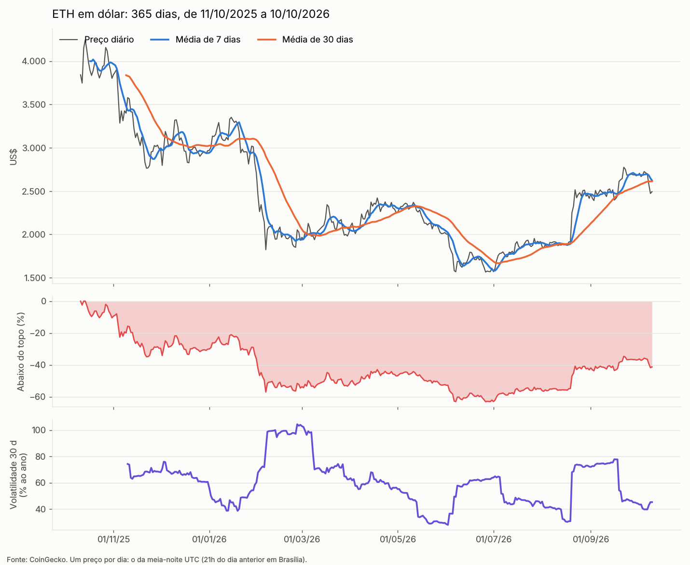
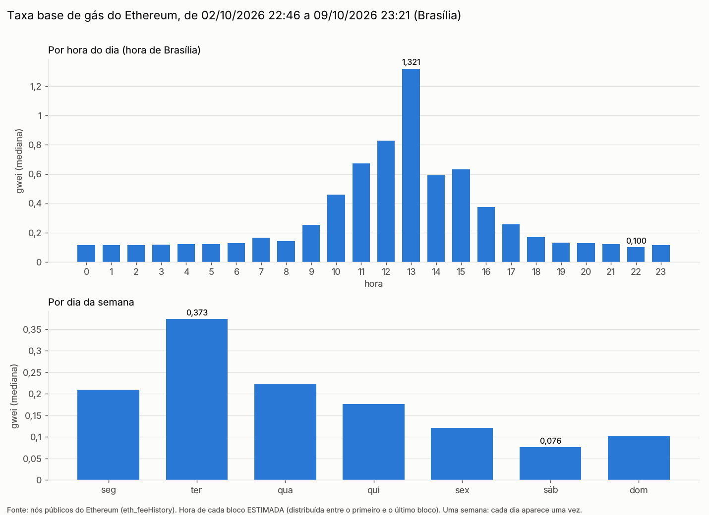
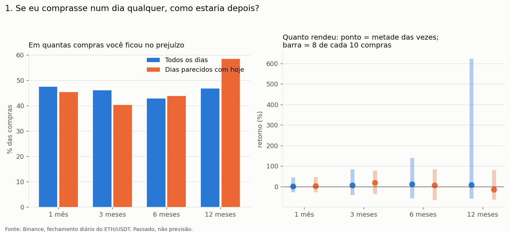

# Análise Ethereum

Estudo do Ethereum com dado público e gratuito, sem chave de API. Não é recomendação de
investimento: tudo aqui é o que aconteceu no passado.

O plano das etapas e as regras de trabalho estão no [`CLAUDE.md`](CLAUDE.md).

## Em uma olhada

| Pergunta | Script | Resultado |
|---|---|---|
| Como o preço do ETH se comportou no último ano? | `01` busca, `02` analisa | [`saidas/precos.png`](saidas/precos.png), [`saidas/resumo_precos.txt`](saidas/resumo_precos.txt) |
| Em qual hora e dia da semana o gás (a taxa da rede) é mais barato? | `03` busca, `04` analisa | [`saidas/gas_por_hora.png`](saidas/gas_por_hora.png) |
| Qual o risco de comprar ETH, e qual o melhor jeito de comprar, desde 2017? | `05` busca, `06` analisa | [`saidas/guia.txt`](saidas/guia.txt) e 3 gráficos `saidas/guia_*.png` |
| Amanhã é um bom momento? (veredito conferido no dia seguinte) | `05` busca, `07` decide | [`saidas/veredito_hoje.txt`](saidas/veredito_hoje.txt), [`saidas/diario_veredictos.csv`](saidas/diario_veredictos.csv) |
| Onde o preço deve fechar amanhã e em 7 dias? Sobe ou cai? (previsão versão 2, todo dia) | `05` busca, `08` prevê | [`saidas/previsao_hoje.txt`](saidas/previsao_hoje.txt), [`saidas/diario_previsao.csv`](saidas/diario_previsao.csv) |
| O ETH segue a curva normal? O passado tem memória? As previsões são sorte? Quanto se perde num dia ruim? Onde o preço pode estar em 1 ano? | `05` busca, `09` testa | [`saidas/estatistica.txt`](saidas/estatistica.txt) |
| Tudo isso num painel, mais simulações | o site (`abrir_site.bat`) | telas no navegador, em `http://127.0.0.1:8010` |

---

## Resultados (dado de 10/10/2026)

### Preço do ETH, 365 dias



- Caiu de US$ 3.841,67 para US$ 2.493,78 (-35,1%).
- A maior queda a partir de um topo foi de -63,1%: de US$ 4.245,45 (14/10/2025) a
  US$ 1.566,01 (26/06/2026).
- A volatilidade de 30 dias (quanto o preço chacoalha, em escala de um ano) está em 45%. A
  média do ano foi 60%.

### Gás por hora e dia da semana (02/10 a 09/10/2026)



- Das 9h às 18h (Brasília) o gás custou 3,6 vezes mais que no resto do dia.
- A hora mais cara foi 13h (16h em UTC: EUA abertos e Europa ainda trabalhando), em 3 dos 5
  dias úteis; na terça foi 7h, e na quinta, 12h. O sábado saiu quase 5 vezes mais barato que a terça.
- É uma semana só: pista, não regra.

### Guia de risco (17/08/2017 a 09/10/2026)



- **Comprar num dia qualquer foi quase cara ou coroa:** em 12 meses, 47% das compras ficaram
  no prejuízo. Metade rendeu mais que +9%; o pior caso foi -92% e o melhor, +2.147%. Mesmo nos
  casos comuns, a compra chegou a cair ~38% em algum momento do ano.
- **Nos dias parecidos com hoje** (preço de 38% a 58% abaixo do recorde), 58% das compras
  estavam no prejuízo 12 meses depois. Vem de só 2 ou 3 grandes quedas (2018 e 2022).
- **Um pouco por mês** ([gráfico](saidas/guia_2_aporte.png)) ganhou só em 38% das vezes e
  terminou, na mediana, igual (US$ 1.118 contra US$ 1.122 de tudo de uma vez). Na média, tudo de
  uma vez rendeu mais (US$ 2.124 contra US$ 1.477), puxado pelas altas grandes. O "por mês" corta
  o pior caso e o melhor.
- **Sinal de médias de 7 e 30 dias** ([gráfico](saidas/guia_3_sinais.png)): US$ 1.000 viraram
  US$ 21.813, contra US$ 2.868 de comprar e esperar. Quase tudo veio de fugir dos tombos de
  2018 e 2022; de 2022 a 2026 perdeu de comprar e esperar. Imposto e custos ficaram de fora.

### Veredito diário

- Placar histórico da regra, de 2017 a 2026, sem espiar o futuro: **51,5%** de acerto em 660
  dias, contra 49,1% de quem dissesse "sobe" nesses mesmos dias. A diferença é do tamanho
  que a sorte explica. O diário ao vivo vai mostrar se ela se repete.
- Ela fica **sem palpite em 85 de cada 100 dias** (no último ano): com centenas de dias
  parecidos, a conta sempre volta para perto de 50%.

### Previsão versão 2 (11/10/2026)

Pedida para dar previsão todo dia. Duas partes: uma **faixa de preço** com 80% de chance
(amanhã e daqui a 7 dias) e a **chance de subir amanhã**, com palpite todo dia.

**Como foi escolhida, sem decorar a prova:** cada candidato foi testado dia a dia, só com o
que se sabia em cada dia. A escolha olhou só **2017 a 2021** (o treino); a nota é de **2022 a
2026** (a prova), anos que nenhum candidato viu ao ser escolhido.

| Sobe ou cai amanhã (10 candidatos, os principais) | Acerto no treino | Acerto na prova |
|---|---|---|
| Dizer "sobe" todo dia (o mínimo a superar) | 52,0% (54,0% nos mesmos dias da escolhida) | 50,3% |
| Regra versão 1 (só nos dias em que arriscou) | 49,8% | 52,7% |
| **Regressão logística, 12 sinais (a escolhida)** | 53,4% | **51,7%** |
| Floresta aleatória (scikit-learn) | 54,7% | 51,3% |
| Gradient boosting (scikit-learn) | 52,0% | 50,1% |
| Vizinhos mais próximos, 12 sinais | 53,9% | 50,3% |

Nenhum candidato prevê a direção de um dia de verdade: a margem de erro da prova é de ±2,4
pontos. Os que mais brilharam no treino (até 55,8%) caíram para cara ou coroa na prova, e
forçar a regra antiga a palpitar todo dia transformou US$ 1.000 em US$ 137 desde 2022. A
escolhida ganhou pela nota de probabilidade no treino (a de Brier, que mede se "48%" quer
dizer mesmo 48%), e é a mais simples. Em acerto, nem no treino ela ganhou de dizer "sobe": nos
mesmos 999 dias (de 08/04/2019 a 2021), 53,4% contra 54,0%. (Cada candidato começa num dia
diferente, porque pede um tanto de passado; por isso a coluna do treino compara janelas
diferentes.) No teste inteiro (2019 a 2026), quando a chance ficou
4 pontos ou mais longe de 50% (força "forte"), o palpite acertou 55,1% em 1.156 dias; esse
número mistura os anos em que a regra foi escolhida, e por isso é só pista.

**Com margem de erro (etapa 9), só na prova:** o sobe ou cai acertou 51,7%, com margem de 49,3%
a 54,0% e p = 0,165: não se separa de cara ou coroa. As faixas cumprem o prometido: 80,3%
(margem de 78,3% a 82,1%) e 80,8% (de 75,5% a 85,3%).

| Faixa de 80% | Dentro no treino | Dentro na prova |
|---|---|---|
| Amanhã (volatilidade EWMA x quantis do passado, a escolhida) | 80,4% | **80,3%** |
| 7 dias (o mesmo método) | 81,5% | **80,8%** |
| Amanhã, quantis dos últimos 30 dias (a primeira ideia) | 74,6% | 75,0% |

**O tamanho do movimento é previsível; a direção, não.** A faixa acerta o que promete porque
dia agitado puxa dia agitado: nos dias de faixa estreita, o dia seguinte mexeu 2,3% em média;
nos de faixa larga, 3,6%.

---

### Estatística (etapa 9, 11/10/2026)

Os fundamentos por trás das frases do site, cada um com teste, e o risco.

- **Os dias extremos são bem mais comuns que a curva normal prevê.** Desde 2017, 41 dias
  passaram de 15% (para cima ou para baixo); a curva normal esperaria 3. Já os dias de mais de
  5% são menos comuns que na curva (630 contra 895): o ETH fica mais tempo calmo e, quando sai
  da calma, sai de vez. Pior dia: -44,6% (12/03/2020).
- **O tamanho do movimento tem memória; a direção, quase nenhuma.** A autocorrelação (o quanto
  um dia se parece com os anteriores) do tamanho passa da faixa do acaso nas 30 defasagens; a da
  direção, em 6 de 30, todas pequenas. É a prova de "faixa funciona, sobe ou cai não".
- **Quinta-feira:** foi o pior dia no treino (até 2021) e continuou o pior na prova (-0,47 ponto
  por dia contra os outros, p = 0,041). É real, mas pequeno: um dia comum mexe uns 4,5%.
- **Num dia ruim (1 em cada 20), a queda passa de 3,7%** (o VaR, com a agitação de agora); quando
  passa, a média é 5,6%. Conferido dia a dia desde 2019: o jeito adaptável é ultrapassado em
  4,8% dos dias (prometido: 5%), mas os dias ruins vêm em grupo; o jeito que usa todo o passado
  por igual é folgado demais (2,9%).
- **Daqui a 1 ano** (10.000 caminhos sorteados com pedaços de 30 dias do passado): 9 em cada 10
  terminam entre US$ 703 e US$ 14.431, e 60 de cada 100 acima do preço de hoje. Conferido em 75
  começos desde 2019: o preço real caiu dentro em 85,3% (prometido 90%); todos os erros foram
  para cima, de leques começados em 2020.

---

## Montar o ambiente

Precisa de **Python 3.11 ou mais novo** e das bibliotecas travadas no
[`requirements.txt`](requirements.txt): `pandas` (tabela e conta), `matplotlib` (gráfico),
`fastapi` e `uvicorn` (só para o site). O resto vem pronto no Python. O site precisa também
do **Node.js** ([nodejs.org](https://nodejs.org)); as bibliotecas dele se instalam sozinhas
na primeira vez que o site abre.

**No computador do Guilherme (`C:\Lab`).** O Lab tem um Python só para todos os projetos,
em `C:\Lab\.venv\`, que já tem as duas bibliotecas. Não crie outro dentro desta pasta.
Biblioteca nova entra só por `C:\Lab\00 - Ambiente\instalar.bat nome`. Para o site, uma
vez: `instalar.bat fastapi` e `instalar.bat uvicorn`.
```
cd /d "C:\Lab"
git clone https://github.com/Guilherme-Filardi/analise-ethereum "04 - Analise Ethereum"
```
Das outras vezes, para trazer o que mudou:
```
cd /d "C:\Lab\04 - Analise Ethereum"
git pull
```

**Em outro computador.** Instale o Python ([python.org](https://www.python.org/downloads/);
no Windows, marque "Add Python to PATH") e depois:
```
git clone https://github.com/Guilherme-Filardi/analise-ethereum
cd analise-ethereum
pip install -r requirements.txt
```

---

## Uso do dia a dia: o veredito e a previsão sozinhos

O `rodar_diario.bat` atualiza o histórico (`05`), dá o veredito (`07`) e a previsão (`08`). O dia da Binance
fecha às 21h em Brasília, então ele roda às 21h30. O que os scripts escrevem vai para
`saidas\log_diario.txt`, que fica só no computador.

| Para | Comando (uma vez só, no Prompt de Comando) |
|---|---|
| Agendar todo dia às 21h30 | `schtasks /create /tn "Analise Ethereum - veredito" /tr "\"C:\Lab\04 - Analise Ethereum\rodar_diario.bat\"" /sc daily /st 21:30` |
| Rodar agora, sem esperar | `schtasks /run /tn "Analise Ethereum - veredito"` (ou dois cliques no `rodar_diario.bat`; a janela fecha sozinha no fim) |
| Rodar depois, se o computador estava desligado às 21h30 | No PowerShell: `Set-ScheduledTask -TaskName "Analise Ethereum - veredito" -Settings (New-ScheduledTaskSettingsSet -StartWhenAvailable)` |
| Tirar o agendamento | `schtasks /delete /tn "Analise Ethereum - veredito" /f` |

- O resultado do dia fica em `saidas\veredito_hoje.txt` e `saidas\previsao_hoje.txt`.
- Se o diário estiver aberto no Excel na hora, o script avisa no `saidas\log_diario.txt` e não
  grava o diário: feche o Excel e rode de novo no mesmo dia, senão aquele dia fica de fora.
- Pode rodar a qualquer hora entre as 21h de um dia e as 21h do seguinte: o veredito vale
  para o dia que ainda está aberto.
- Dia em que nada rodou fica de fora do diário (anotar depois, já sabendo o resultado, não
  seria um veredito de verdade).

Para o diário aparecer no GitHub, de vez em quando:
```
cd /d "C:\Lab\04 - Analise Ethereum"
git add dados saidas
git commit -m "Diário de vereditos atualizado"
git push
```

---

## O site

Dois cliques no **`abrir_site.bat`**. Ele abre uma janela só, como o `abrir_papel.bat` do
PAPEL, e o navegador em `http://127.0.0.1:8010`. Se o Tailscale estiver instalado, ele também
liga o **link da internet** e mostra na janela (já copiado, é só colar e mandar). Para
desligar tudo, aperte **Q** na janela.

No computador, o menu fica à esquerda; no celular, numa barra embaixo, como num aplicativo.
Tema claro ou escuro: segue o do aparelho, e o botão do menu troca (fica guardado no navegador).

| Tela | O que mostra |
|---|---|
| **Painel** (a primeira) | Em cima, três perguntas com a resposta grande: **quanto vale hoje**, **onde deve fechar amanhã** (a faixa de 80%) e **sobe ou cai** (uma barra dividida, "Sobe 49%" contra "Cai 51%"). Embaixo, o gráfico do preço, como o preço andou (7 dias, 30 dias, 1 ano, recorde), a faixa de 7 dias, a faixa prevista contra o preço que veio nos últimos 60 dias e o placar das previsões |
| **Estatística** | Duas abas. *Fundamentos*: os placares com margem de erro, a memória do preço (direção contra tamanho), os dias extremos contra a curva normal e o dia da semana com treino e prova. *Risco e simulação*: a queda num dia ruim (VaR), com os dois jeitos conferidos, e o leque do próximo ano |
| **Previsão** | A previsão por dentro: as duas faixas, a chance de subir e os sinais que mais pesaram hoje; a faixa contra o real em 180 dias; se a chance acerta o que promete (calibração); o acerto pela força do palpite; ano a ano; e a regra antiga (versão 1) ao lado. Tem o botão **Buscar preço agora** (faz o mesmo que o agendamento das 21h30; só aparece no próprio computador) |
| **Simular** | *Se eu tivesse comprado* (quanto, quando comprou e quando vendeu: quanto teria hoje e o pior momento no caminho); *Se eu comprar hoje* (caso ruim, típico e bom em 1 a 12 meses, pelo que aconteceu no passado); *Se eu seguisse os palpites* da regra antiga (contra comprar e esquecer) |
| **O que o estudo mostra** | As conclusões do guia e do gás, em frases com um número grande. Os detalhes e os gráficos ficam num "Ver os detalhes" |
| **Histórico** | Cada previsão anotada antes de acontecer e o que veio depois: a da versão 2 (faixa e palpite) e a da regra antiga, em abas |

**O gráfico do preço** tem três jeitos de ver: **Linha** (o fechamento de cada dia),
**Velas** (abertura, fechamento, mais alto e mais baixo) e **Sobe e desce** (uma barra por
vez que subiu ou caiu). Nas velas e no sobe e desce, a **escala** escolhe o que é cada barra:
**dia a dia**, semana ou mês. Ao passar o mouse (ou o dedo), aparecem os 4 preços e a variação.

Toda explicação fica num **(i)** que abre ao clicar. As datas se escolhem por dia, mês e ano
(ou por atalhos como "1 ano atrás"), sem calendário, e o resultado aparece sozinho ao mudar
qualquer escolha.

- **Como funciona:** a API em Python (`api/servidor.py`, FastAPI) faz todas as contas,
  reaproveitando as dos scripts `06`, `07` e `08` (a conta da previsão fica guardada até o
  arquivo de preços mudar). A tela (`site/`, Vite, React e TypeScript, como
  o PAPEL) só pede os números e desenha. A API também entrega a tela pronta, por isso basta
  uma porta.
- **Quem pode abrir:** a API escuta só no próprio computador (`127.0.0.1`). Quem abre para a
  internet é o Tailscale Funnel (abaixo). Sem senha, por decisão do Guilherme: o repositório
  já é público. De fora, o botão "Buscar agora" não aparece, e a API recusa o pedido de baixar.
  No próprio computador, ela só aceita esse pedido vindo da tela do site (outra página aberta no
  navegador não consegue mandar), e uma busca por vez. Endereço que não é da API sempre devolve
  a tela, sem virar caminho de arquivo; de `saidas/` saem só os gráficos PNG (o
  `log_diario.txt` e os arquivos de exemplo ficam só no computador).
- **Portas:** 8010 no dia a dia. Fogem das do PAPEL (5173, 4173 e 8000), então os dois podem
  ficar abertos juntos.
- **Primeira vez:** o `abrir_site.bat` roda o `npm install` sozinho (uns minutos). Depois,
  ele reconstrói a tela só quando algum arquivo dela muda.
- **Para mexer na tela** (desenvolvimento, duas janelas): numa, ligue a API com
  `"..\.venv\Scripts\python.exe" -m uvicorn api.servidor:app --port 8010`; na outra,
  `cd site` e `npm run dev`, e abra `http://localhost:5180`.

### Abrir para a internet (Tailscale Funnel)

Para outra pessoa abrir o site de qualquer lugar, pelo celular ou pelo computador, sem estar
no seu Wi-Fi. O Tailscale cria um link fixo, com cadeado (https), e repassa as visitas para o
seu computador. É grátis. A outra pessoa não instala nada: só abre o link.

**Uma vez só, no seu computador:**

1. Criar a conta em [tailscale.com](https://tailscale.com) (dá para entrar com a conta do Google).
2. Instalar o Tailscale para Windows ([tailscale.com/download](https://tailscale.com/download))
   e entrar com a mesma conta. Ele fica rodando perto do relógio.
3. Ligar o Funnel (o link público) pela primeira vez:
   ```
   tailscale funnel 8010
   ```
   Na primeira vez, ele mostra um endereço para autorizar. Abra no navegador, autorize, volte
   ao Prompt e aperte Ctrl + C.

**Todo dia:** dois cliques no `abrir_site.bat`. A janela mostra:
```
  Link para mandar (ja copiado, e so colar):
    https://nome-do-computador.algo.ts.net
```
Esse link é sempre o mesmo. Mande uma vez.

- O site só abre pelo link enquanto o computador estiver ligado **e** a janela do
  `abrir_site.bat` aberta. Aperte **Q** para desligar: o link para junto.
- Se a janela for fechada no X, o link continua existindo, mas mostra erro até o
  `abrir_site.bat` ser aberto de novo.
- Sem o Tailscale instalado, o `abrir_site.bat` funciona igual, só no próprio computador.

---

## Rodar tudo à mão

O `01`, o `03` e o `05` precisam de internet; os outros, não.
```
cd /d "C:\Lab\04 - Analise Ethereum"
"..\.venv\Scripts\python.exe" src\01_precos.py
"..\.venv\Scripts\python.exe" src\02_analise_precos.py
"..\.venv\Scripts\python.exe" src\03_gas.py
"..\.venv\Scripts\python.exe" src\04_analise_gas.py
"..\.venv\Scripts\python.exe" src\05_historico_binance.py
"..\.venv\Scripts\python.exe" src\06_guia.py
"..\.venv\Scripts\python.exe" src\07_veredito.py
"..\.venv\Scripts\python.exe" src\08_previsao.py
```
Fora do Lab, troque `"..\.venv\Scripts\python.exe"` por `python` e `\` por `/`.

Cada script imprime no fim o que gravou e um número de conferência, por exemplo
`3.341 dias, de 17/08/2017 a 09/10/2026`.

### Testar sem internet

Os `dados/exemplo_*.json` são **respostas inventadas**, no formato exato de cada fonte. O
que sai deles ganha `exemplo_` no nome, os gráficos avisam "EXEMPLO (dado fictício)" e nada
disso vai para o Git.
```
cd /d "C:\Lab\04 - Analise Ethereum"
"..\.venv\Scripts\python.exe" src\01_precos.py dados\exemplo_coingecko.json
"..\.venv\Scripts\python.exe" src\02_analise_precos.py dados\exemplo_precos_eth.csv
"..\.venv\Scripts\python.exe" src\03_gas.py dados\exemplo_gas_rpc.json
"..\.venv\Scripts\python.exe" src\04_analise_gas.py dados\exemplo_gas.csv
"..\.venv\Scripts\python.exe" src\05_historico_binance.py dados\exemplo_binance_rpc.json
"..\.venv\Scripts\python.exe" src\06_guia.py dados\exemplo_eth_diario_binance.csv
"..\.venv\Scripts\python.exe" src\07_veredito.py dados\exemplo_eth_diario_binance.csv
"..\.venv\Scripts\python.exe" src\08_previsao.py dados\exemplo_eth_diario_binance.csv
"..\.venv\Scripts\python.exe" src\09_estatistica.py dados\exemplo_eth_diario_binance.csv
```

### Conferir as contas

São 50 testes com números pequenos e conta feita à mão:
```
cd /d "C:\Lab\04 - Analise Ethereum"
"..\.venv\Scripts\python.exe" -m pytest testes
```
A `.venv` do Lab não tem o `pytest`. Sem ele, cada arquivo de `testes\` também roda sozinho, por exemplo
`"..\.venv\Scripts\python.exe" testes\test_veredito.py`.

---

## Como cada etapa funciona

```
Internet                 dados/ (bruto)               saidas/ (resultado)
CoinGecko  ── 01 ──>  precos_eth.csv         ── 02 ──>  precos.png + resumo_precos.txt
Nós do ETH ── 03 ──>  gas.csv                ── 04 ──>  gas_por_hora.png
Binance    ── 05 ──>  eth_diario_binance.csv ── 06 ──>  guia.txt + guia_1..3.png
                                             ── 07 ──>  veredito_hoje.txt + diario_veredictos.csv
                                             ── 08 ──>  previsao_hoje.txt + diario_previsao.csv
                                             ── 09 ──>  estatistica.txt
```
Quem busca só guarda o dado do jeito que chegou; quem calcula não usa internet. Se uma conta
estiver errada, o dado original continua intacto para refazer.

| Script | O que faz |
|---|---|
| `01_precos.py` | Pede à CoinGecko 365 dias do ETH (preço, valor de mercado, volume). Se falhar, não grava nada |
| `02_analise_precos.py` | Um preço por dia (o da meia-noite UTC, 21h do dia anterior em Brasília). Calcula retorno diário, médias de 7 e 30 dias, volatilidade de 30 dias (desvio padrão do retorno vezes raiz de 365) e a maior queda a partir de um topo |
| `03_gas.py` | Pede a nós públicos do Ethereum a taxa base dos últimos 50.400 blocos (7 dias), 1.024 por pedido. Tenta 3 nós, um depois do outro. A hora de cada bloco é **estimada**: a real do primeiro e do último, e os do meio espalhados por igual |
| `04_analise_gas.py` | Passa para a hora de Brasília (UTC menos 3) e pega a **mediana** por hora e por dia da semana. Mediana, porque os picos chegam a 90 vezes o normal e distorceriam a média |
| `05_historico_binance.py` | Pede à Binance o fechamento diário do ETH/USDT desde 17/08/2017, 1.000 dias por pedido, com um endereço reserva. O dia ainda aberto fica de fora |
| `06_guia.py` | Três perguntas com o preço real: comprar num dia qualquer (e em dias parecidos com hoje), tudo de uma vez ou por mês, e se os sinais de médias ganham de comprar e esperar (com taxa de 0,1% e teste em cada metade do período) |
| `07_veredito.py` | Olha a tendência (média de 7 contra a de 30), a distância do recorde e a última semana; procura os dias parecidos no passado e vê quantos subiram no dia seguinte. **Bom** com 55% ou mais, **ruim** com 45% ou menos, **sem vantagem** no meio ou com menos de 30 dias parecidos. A regra é **congelada** (versão 1, de 10/10/2026) |
| `08_previsao.py` | A previsão versão 2. **Faixa de 80%** para amanhã e para 7 dias: a volatilidade de hoje (EWMA de 0,94, uma média dos movimentos que pesa mais os dias recentes) vezes os quantis de 10% e 90% de todos os movimentos já terminados. **Chance de subir**: regressão logística com freio (L2 = 300) sobre 12 sinais, refeita a cada 30 dias só com o passado; palpite "sobe" acima de 50%, "cai" no resto, com força fraca, média ou forte pela distância até 50%. Congelada (versão 2, de 11/10/2026). Dado curto demais sai com aviso, sem gravar |
| `09_estatistica.py` | Os testes estatísticos, sem biblioteca nova (as fórmulas estão no próprio script): momentos e Jarque-Bera, extremos contra a curva normal, autocorrelação com Ljung-Box, dia da semana com treino e prova (Welch), VaR de 95% histórico e adaptável com os testes de Kupiec e Christoffersen, o leque de 1 ano por bootstrap em blocos de 30 dias com conferência no passado, e a margem de erro de Wilson dos placares (a versão 2 só na prova, 2022 em diante) |

Nos scripts `06`, `07`, `08` e `09` e no simulador do site, um teste garante que nenhuma conta usa um
preço que ainda não se conhecia naquele dia.

---

## Se der erro

| Mensagem | O que quer dizer | O que fazer |
|---|---|---|
| `can't open file ... src\...` | O script não está na pasta | `git pull` |
| `Falhou o download da CoinGecko (...)` | A CoinGecko não respondeu ou limitou (~30 pedidos por minuto) | Esperar um minuto e rodar de novo. Nada foi gravado |
| `Falhou o download (todos os nós falharam ...)` | Os 3 nós recusaram; a mensagem mostra o motivo de cada um | Rodar mais tarde. Nó que mudar de regra sai da lista `NOS`, no topo do `src\03_gas.py` |
| `Falhou o download (todos os endereços falharam ...)` | A Binance não respondeu nos dois endereços | Rodar mais tarde. Nada foi gravado |
| `ATENÇÃO: o último dia do dado é ...` | O histórico está velho | Rodar o `05` e depois o `07` |
| `No module named pandas` | O Python usado não tem as bibliotecas | No Lab, use `"..\.venv\Scripts\python.exe"`. Fora dele, `pip install -r requirements.txt` |
| `Falta o fastapi ou o uvicorn` (no `abrir_site.bat`) | O Python do Lab ainda não tem o que o site usa | No `00 - Ambiente`: `instalar.bat fastapi` e `instalar.bat uvicorn` |
| `A API nao respondeu em 60 s` | A API do site não ligou | Abrir o arquivo de registro que a janela mostra; o erro está no fim dele |
| Site abre com "A API não respondeu" | A janela do `abrir_site.bat` foi fechada | Abrir o `abrir_site.bat` de novo |
| `Nao consegui ligar o link da internet` | O Funnel ainda não foi autorizado, ou o Tailscale está desconectado | Fazer o passo 3 de "Abrir para a internet". Se pedir permissão de administrador, abrir o Prompt como administrador só para esse passo |
| O link mostra erro para a outra pessoa | O `abrir_site.bat` não está aberto, ou o computador está desligado | Abrir o `abrir_site.bat` |

---

## Pastas

| Pasta ou arquivo | O que tem |
|---|---|
| `src/` | Os 7 scripts, numerados na ordem em que rodam |
| `dados/` | O dado bruto, do jeito que veio da fonte, e as respostas inventadas `exemplo_*.json` |
| `saidas/` | Gráficos, relatórios e o diário. Nascem dos scripts; não edite à mão |
| `testes/` | Os testes das contas |
| `api/` | A API do site: `simulador.py` (as contas) e `servidor.py` (os endereços) |
| `site/` | A tela do site (React). `node_modules` e `dist` se refazem e ficam fora do Git |
| `rodar_diario.bat` | Roda o veredito e a previsão do dia; é o que o Agendador do Windows chama |
| `abrir_site.bat` | Abre o site numa janela só |

Cada script acha as pastas a partir de onde ele mesmo está, então roda igual no Windows, no
Linux e no Mac.

### Glossário

| Termo | O que é |
|---|---|
| ETH | A moeda da rede Ethereum |
| Gás | A taxa paga para a rede processar uma transação |
| Taxa base | A parte mínima do gás. Sobe quando o bloco anterior ficou mais da metade cheio e cai quando ficou menos, no máximo 12,5% por bloco |
| gwei | Unidade do gás: 1 gwei = 0,000000001 ETH |
| Bloco | Um pacote de transações. Sai um a cada 12 segundos |
| UTC | O horário de referência mundial. Brasília = UTC menos 3 horas |
| USDT | Moeda digital presa ao dólar (1 USDT ≈ US$ 1) |
| Média móvel | A média dos últimos N dias, recalculada a cada dia |
| Recorde (topo) | O maior preço de fechamento visto até aquele dia |
| Mediana | O valor do meio: metade fica abaixo, metade acima |
